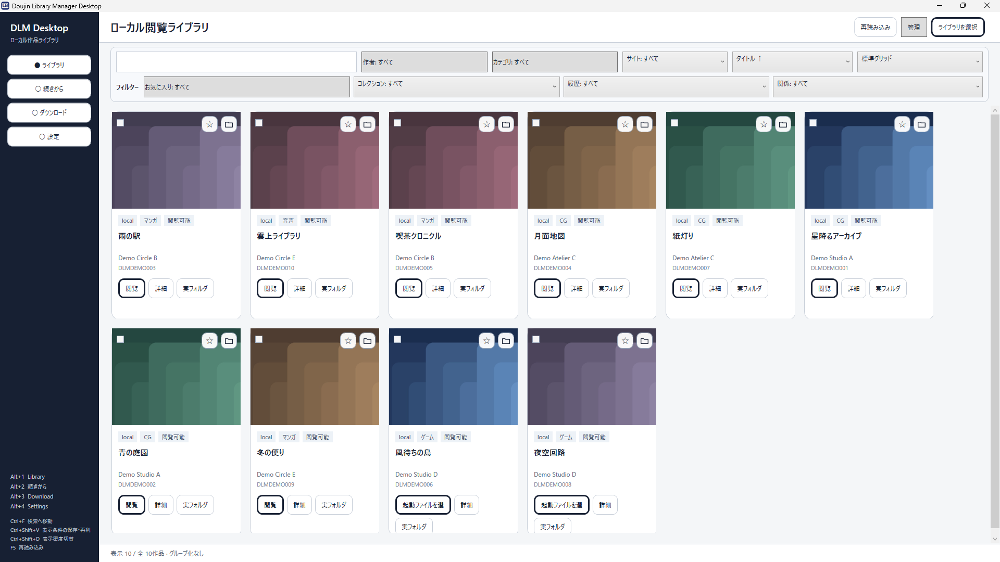
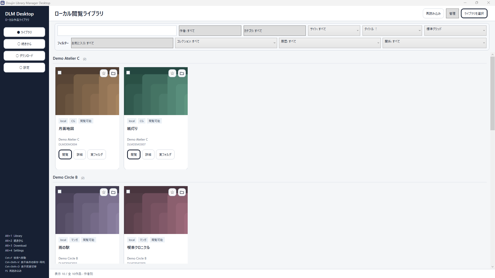
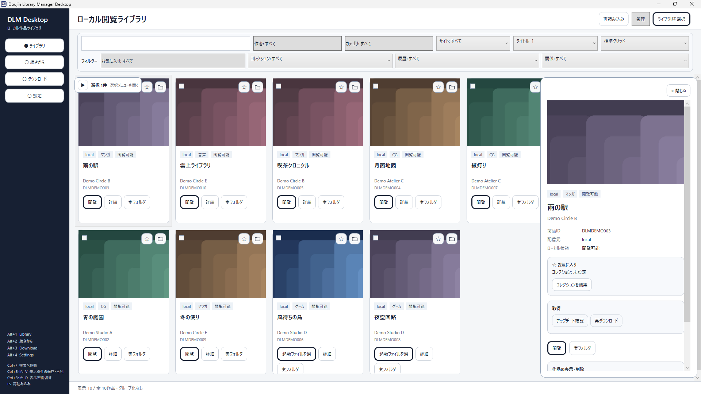
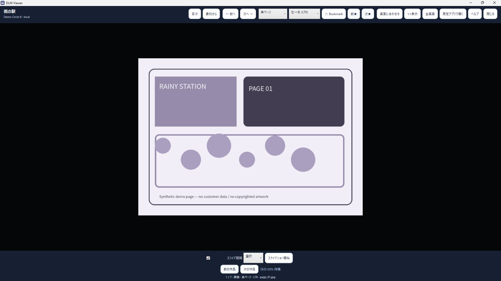
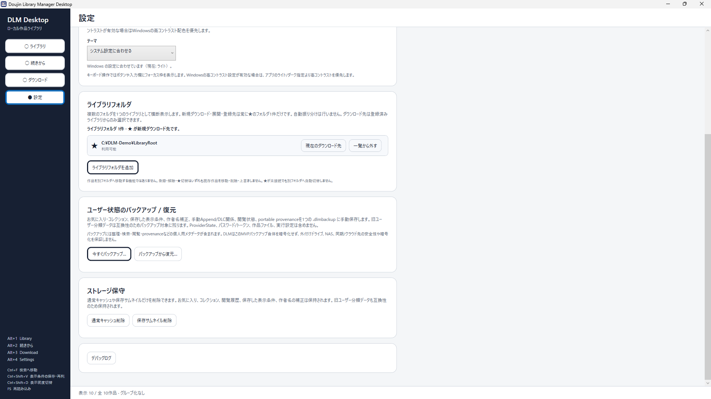

# DLM Desktop — Doujin Library Manager Desktop

**増えた同人・デジタル作品を、PC上でまとめて整理・閲覧するローカル中心のライブラリ。**

DLM Desktop is a local-first Windows library by Ertelun for organizing, finding, and viewing digital works you keep on your PC.

**1.3.2（r213）正式リリース / Stable release · 日本語 / English · Windows x64 · ZIP · unsigned · free**

[Windows x64 ZIPをダウンロード / Download Windows x64 ZIP](https://github.com/Ertelun/dlm-desktop/releases/download/v1.3.2/DLM-Desktop-v1.3.2-r213-win-x64-Compact.zip) · [正式リリース / Stable release](https://github.com/Ertelun/dlm-desktop/releases/tag/v1.3.2) · [更新内容 / Release notes](RELEASE_NOTES-r213-JA-EN.md)

配布元はこのErtelun GitHub Releaseです。ダウンロードするファイルは **`DLM-Desktop-v1.3.2-r213-win-x64-Compact.zip`** です。

This Ertelun GitHub Release is the canonical distribution source. Download **`DLM-Desktop-v1.3.2-r213-win-x64-Compact.zip`**.

## 起動方法 / Getting started

1. 以前のDLM Desktopを終了します。 / Close any previously running DLM Desktop.
2. ZIPを新しい空のフォルダにすべて展開します。 / Extract the entire ZIP into a new, empty folder.
3. `DoujinLibraryManagerDesktop.exe` を起動します。 / Run `DoujinLibraryManagerDesktop.exe`.

展開直後の最上位は次の3項目です。DLLやランタイムは `app/` にまとめています。EXEと `app/` を同じフォルダに置いてください。

The extracted root contains these three items. DLLs and the bundled runtime live in `app/`; keep it beside the EXE.

```text
DoujinLibraryManagerDesktop.exe
README.txt
app/
```

.NETランタイムは同梱しています。埋め込みブラウザには **Microsoft Edge WebView2 Runtime** が必要です。詳細資料と依存ソフトウェアのライセンス表記は `app/docs/` にあります。既存のユーザー設定とライブラリを利用できます。

The .NET runtime is bundled. The embedded browser requires **Microsoft Edge WebView2 Runtime**. Detailed documentation and dependency notices are in `app/docs/`. Existing user settings and libraries can be used with this release.

## 主な機能 / Main features

- 登録済みライブラリの整理・検索・作者別表示 / Organize, search, and group registered libraries by creator.
- 画像・PDF等の対応形式をローカルで閲覧し、閲覧位置を保存・再開 / View supported local image/PDF content and resume reading.
- DLMユーザー状態のBackup / Restore / Back up and restore DLM user state.
- DLsite、DMM/FANZA、itch.io、BOOTH、Gumroad、GOGの公式画面で操作したダウンロードの保存・検証・登録を補助 / Assist with saving, validating, and registering supported downloads initiated by the user on official store pages.
- Fantia、pixivFANBOX、Patreon、Ci-enでは、選択した1投稿についてユーザーが明示的に保存した画像・添付ファイルをまとめて登録 / Group images and attachments explicitly saved by the user from a selected post.

対応範囲は配信形式によって異なります。[Provider Capabilities](PROVIDER_CAPABILITIES.md) で各フローを確認してください。任意の手元フォルダを新規作品として登録する独立したManual Local Intakeは提供していません。一部の作品詳細画面にあるフォルダ選択は、既存の取得フローの検証補助です。

Support depends on the delivery mode; see [Provider Capabilities](PROVIDER_CAPABILITIES.md). Standalone registration of arbitrary local folders is not provided. Folder selection in some work-detail screens is a validation helper for existing acquisition flows.

## 1.3.2の変更点 / Changes in 1.3.2

- 一時的なデバッグログボタンを削除 / Remove the temporary debug-log button.
- DLsiteの `part1.exe` と後続partファイルを同一作品の「分割ダウンロード」フォルダへ原本のまま保存 / Keep DLsite multipart downloads together under the same work without joining or automatically running them.
- Gumroad/GOGの作品情報・サムネイル取得、FANBOXの保存先作成、Patreon/Ci-en等の複数画像保存を修正 / Fix Gumroad/GOG metadata and thumbnails, FANBOX save-directory creation, and multiple-image saves without overwriting distinct files.
- Fantiaの表示回復用キャッシュ処理、Ci-enからDLsite作品・予告作品へのリンク引き継ぎを追加 / Add Fantia display recovery and handoff of supported Ci-en links to DLsite work/announcement pages.
- GOG受付確定の操作と保存・確認中の件数を目立つ位置へ表示 / Make GOG finalization and downloading/verifying counts more visible.

**GOGは必要なファイルをすべて保存してから「GOG受付を確定して登録」を押してください。** ファイルを同一作品として登録する区切りをユーザーが指定します。保存・確認中は確定できません。

**For GOG, save all required files, then click “Finalize GOG intake and register” (`GOG受付を確定して登録`).** This marks the files to group as one work. Finalization waits until downloads and validation finish.

## 言語 / Language

- UI language: **System / 日本語 / English**. 変更後は再起動して反映します。 / Restart DLM Desktop after changing the language.
- 作品名・作者名・サイト由来メタデータは元の言語のままです。 / Work titles, creator names, and provider metadata remain in their original language.

## 配布物と検証 / Package and verification

Windows x64向けのZIP配布です。ARM64はこのリリースの検証対象に含めていません。この配布物は **コード署名なし** です。WindowsでUnknown Publisher / SmartScreenの表示が出る場合があります。

This release is a Windows x64 ZIP. ARM64 has not been qualified. The package is **unsigned**; Windows may show Unknown Publisher / SmartScreen notices.

ZIPのSHA-256 / ZIP SHA-256:

```text
a145ac780de0dfe715d4bfc8540a436a815d42f21f8466131b30ad53ebc39ded
```

[SHA256SUMS.txt](SHA256SUMS.txt) とRelease添付のチェックサムでも確認できます。SHA-256は公開したファイルとの同一性を確認するためのものです。

The checksum is also available in [SHA256SUMS.txt](SHA256SUMS.txt) and the release checksum asset. It verifies identity with the published file.

Releaseビルドは警告0・エラー0、全17テストプロジェクトが成功しました。配布ZIPを日本語・空白を含むパスへ展開し、起動と同梱ランタイムの読み込みを確認しています。詳細は [検証記録 / Verification](RELEASE_VERIFICATION-r213.json) と [Provenance](PROVENANCE.json) にあります。記録した検査範囲についての結果であり、全サイトの全配信形式に対する動作保証ではありません。

The Release build completed with zero warnings/errors and all 17 test projects passed. Launch and bundled-runtime loading were verified from the extracted ZIP in a path containing Japanese characters and spaces. See [Verification](RELEASE_VERIFICATION-r213.json) and [Provenance](PROVENANCE.json) for the scope of these checks; they do not qualify every delivery mode on every site.

このリポジトリは配布物・公開資料の提供用です。GitHubが自動生成する “Source code” ZIP/TARはこの公開リポジトリの資料であり、アプリのビルドソースではありません。

This repository hosts distribution files and public documentation. GitHub's automatically generated “Source code” ZIP/TAR contains this repository's documentation, not the application's build source.

## 利用範囲 / Use and support

ログイン・購入・ダウンロード開始はユーザーが公式画面で操作します。閲覧専用・公式プレイヤー専用・DRM管理のコンテンツは各サービスの公式手段を利用してください。投稿の一括巡回・バックグラウンド同期は提供していません。

Users perform sign-in, purchases, and download initiation on official pages. Viewer-only, official-player-only, and DRM-controlled content remains on provider official routes. Post crawling and background synchronization are not provided.

**DLM DesktopはErtelunによる独立したアプリケーションであり、対応サイトの公式アプリ・提携製品ではありません。**

**DLM Desktop is an independent application by Ertelun and is not an official, affiliated, or endorsed product of the listed providers.**

1.3.2は無料です。コアのローカル利用に支払い・DLMアカウント・サブスクリプションは必要ありません。大容量作品の検証・コピー・登録には時間がかかる場合があります。Backup / RestoreはDLMユーザー状態を対象とし、元の作品ファイル全体のバックアップではありません。

Version 1.3.2 is free. Core local use requires no payment, DLM account, or subscription. Validation, copying, and registration of large works may take time. Backup / Restore covers DLM user state rather than all original work files.

- [不具合報告 / Bug reports](https://github.com/Ertelun/dlm-desktop/issues) · [Feedback guidance](FEEDBACK.md)
- [Known limitations](KNOWN_LIMITATIONS.md) · [Privacy](PRIVACY.md) · [Security policy](SECURITY.md)
- [1.3.2 release notes](RELEASE_NOTES-r213-JA-EN.md) · [Previous Public Beta 2 notes](RELEASE_NOTES-r98-JA-EN.md)

公開Issueには再現可能な既存機能の不具合を最小限の情報で報告してください。脆弱性はGitHubの **Security → Report a vulnerability** を使用し、資格情報・購入データ・個人情報を公開しないでください。

Report reproducible bugs in existing features with minimal information. Use GitHub **Security → Report a vulnerability** for sensitive security reports; keep credentials, purchased content, and personal information private.

## 参考画面 / Reference screenshots

以下は以前のPublic Betaで撮影した公開用synthetic demo libraryです。1.3.2の最新画面とは一部異なります。顧客データ・購入履歴・実アカウント情報・作品の実画像は使用していません。

These synthetic demo screenshots were captured for an earlier Public Beta and may differ from 1.3.2. They contain no customer data, purchase history, real account information, or actual work imagery.

### Library overview



<table>
<tr>
<td width="50%">

**作者別グルーピング / Creator grouping**



</td>
<td width="50%">

**作品詳細 / Work details**



</td>
</tr>
<tr>
<td width="50%">

**Viewer**



</td>
<td width="50%">

**Settings / Backup & Restore**



</td>
</tr>
</table>
