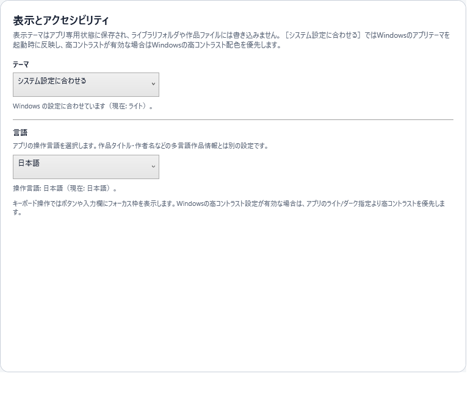
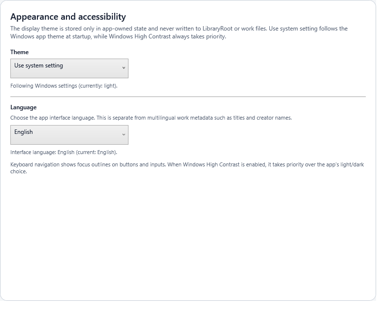

# DLM Desktop — Doujin Library Manager Desktop

**増えた同人・デジタル作品を、PC上でまとめて整理・閲覧するローカルライブラリ。**

DLM Desktop is a local Windows library by Ertelun for organizing, finding and viewing digital works you keep on your PC.

**1.3.13（r224）正式版 / Stable release · 日本語 / English · Windows x64 · ZIP · free · unsigned**

[Windows x64 ZIPをダウンロード / Download Windows x64 ZIP](https://github.com/Ertelun/dlm-desktop/releases/download/v1.3.13/DLM-Desktop-v1.3.13-r224-win-x64.zip) · [正式リリース / Stable release](https://github.com/Ertelun/dlm-desktop/releases/tag/v1.3.13) · [更新内容 / Release notes](RELEASE_NOTES-r224-JA-EN.md)

**[マニュアル / User manual](MANUAL.md)** · [日本語](manual/ja.md) · [English](manual/en.md)

[開発支援のご案内 / Sponsorship information](SUPPORT.md) · **月額支援の申し込み・決済は未開始 / Monthly sponsorship signups and payments have not started**

**1.3.13/r224：Chromiumの新しいCritical問題への緩和策として、埋込みブラウザーを一時停止しています。ライブラリ整理・検索・ローカル閲覧・手動取り込みは利用できます。ブラウザーを必要とする操作とブラウザーキャッシュ管理は停止中です。DLMを終了し、正式ZIP全体を新しい空フォルダーへ展開して起動してください。再開には検証済みの修正版DLMが必要で、WebView2の更新だけでは解除されません。メインアプリの同梱.NET 10.0.14と実Runtimeガードにより、公開メタデータ・サムネイル通信のBrotli対応を安全に復旧しました。ブラウザー停止は継続します。**

**1.3.13/r224 temporarily disables the embedded browser to mitigate new Critical Chromium issues. Library organization, search, local viewing and Manual Intake remain available. Browser-dependent provider workflows and browser cache management are paused. Close DLM and extract the full official ZIP into a new empty folder. Recovery requires a reviewed DLM release; updating WebView2 alone does not lift the hold. HTTP Brotli support for public metadata/thumbnails is restored with patched .NET10.0.14 bundled with the main application and an actual-runtime guard; the browser hold remains.**

## 起動方法 / Getting started

1. 以前のDLM Desktopを終了します。 / Close any previously running DLM Desktop.
2. ZIPを新しい空のフォルダへすべて展開します。 / Extract the entire ZIP into a new, empty folder.
3. `DoujinLibraryManagerDesktop.exe` を起動します。 / Run `DoujinLibraryManagerDesktop.exe`.

最上位は次の3項目です。appフォルダをEXEと同じ場所に置いてください。

The root contains three items. Keep the app folder beside the EXE.

```text
DoujinLibraryManagerDesktop.exe
README.txt
app/
```

.NETランタイムを同梱しています。埋込みブラウザーは安全のため一時停止中です。詳細資料とライセンスはapp/docsにあります。既存のライブラリとユーザー設定を利用できます。

.NET is bundled. The embedded browser is temporarily paused for security. Documentation and licenses are in app/docs. Existing libraries and user settings remain usable.

## 言語 / Language

「設定」→「表示とアクセシビリティ」→「言語」で、日本語・英語・システム設定を選べます。開いている画面にも反映します。メニュー、ボタン、説明、進捗、エラー、確認ダイアログを再調査・修正しました。作品名・作者名・ファイル名や保存済みの識別情報は保持します。

Choose Settings → Appearance and accessibility → Language for Japanese, English or the system language. Open screens update immediately. This release repairs menus, buttons, descriptions, progress, errors and confirmation dialogs. Work titles, creator names, filenames and stored identities are preserved.

各サービスのWebページとWindows標準ファイル選択画面は、それぞれの言語設定に従います。

Provider web pages and Windows file dialogs follow their own language settings.

| 日本語設定 / Japanese | 英語設定 / English |
|---|---|
|  |  |

画像は合成データによる検証画面です。実アカウント、購入履歴、作品画像は含みません。

These qualification screenshots use synthetic data and contain no real accounts, purchase history or work imagery.

## 主な機能 / Main features

- 登録済みライブラリの検索・並び替え・作者別表示・コレクション / Search, sort, group by creator and organize collections.
- 対応する画像・PDF・動画・音声・3Dモデル等のローカル閲覧 / View supported local images, PDFs, video, audio and 3D models.
- 閲覧位置の保存・再開、ユーザー設定のバックアップ・復元 / Resume reading and back up or restore user state.
- 対応する公式ダウンロードの保存・検証・登録補助 / Assist with saving, validating and registering supported downloads from official provider pages.
- 選択した投稿の画像・添付ファイルを同一投稿として整理 / Group explicitly saved images and attachments from a selected post.

対応範囲は [Provider Capabilities](PROVIDER_CAPABILITIES.md) と [Known Limitations](KNOWN_LIMITATIONS.md) を確認してください。

See [Provider Capabilities](PROVIDER_CAPABILITIES.md) and [Known Limitations](KNOWN_LIMITATIONS.md) for supported routes.

## 1.3.8の全画面削除・連続閲覧 / Fullscreen deletion and continuous viewing in 1.3.8

全画面の **Shift+Delete** で表示中の作品の完全削除を確認できます。初期選択はキャンセルです。削除後は同じ全画面で、現在の絞り込みと表示順・ランダム設定に従って次の作品へ進みます。削除の差分更新と古い閲覧処理・更新予約のキャンセルにより、画像が消えたまま次が出ない問題に対処しました。

**Shift+Delete in fullscreen** confirms permanent deletion of the current work. Cancel is selected by default. After success, viewing continues in the same window using the current filter and ordered/random mode. Targeted updates and cancellation of obsolete viewing work and refreshes address the blank view after deletion.

削除中は進捗・経過時間を表示します。Escでライブラリに戻れますが、確認済みの削除は続行します。作品フォルダーの完全削除は元に戻せません。物理削除にかかる時間はファイル数やストレージに依存します。詳細は [今回のリリースノート](RELEASE_NOTES-r219-JA-EN.md) を参照してください。

During deletion, progress and elapsed time are shown. Esc returns to the library while confirmed deletion continues. Permanent folder deletion cannot be undone; its duration depends on file count and storage. See the [release notes](RELEASE_NOTES-r219-JA-EN.md).

## セキュリティ停止と再開条件 / Security hold and recovery

CVE-2026-118306、CVE-2026-118331、CVE-2026-118348、CVE-2026-118344は、GoogleがCriticalとしたFileSystem・FileAPI・Skia・Layoutの問題です。Microsoftは修正版を準備中です。DLMは共通の中央ゲートでRuntime検出・プロフィール・Environment・controllerの作成前にブラウザー操作を拒否します。既存のライブラリ・ローカル閲覧・手動取り込みは維持しています。

Google classifies these four Chromium issues as Critical. Microsoft is preparing a fix. DLM blocks its central browser gate before Runtime discovery, profile, environment or controller creation. The mitigation removes this product's browser exposure; it does not patch the external engine or certify every dependency. Recovery requires vendor fixes, reviewed product validation and a future DLM recovery release.

[今回のリリースノート / Release notes](RELEASE_NOTES-r224-JA-EN.md) · [Security Policy](SECURITY.md)

## 1.3.5から引き継ぐ修正 / Fixes retained from 1.3.5

多数の同時ダウンロードで進捗通知をまとめて画面負荷を軽減し、総サイズが不明な転送でも受信済み容量を表示します。遅れて届いた通知が待機・検証・キャンセルの表示を上書きする問題も修正しました。

Coalesces concurrent download progress updates, displays received bytes when the total size is unknown, and prevents late callbacks from overwriting waiting, validation or cancellation states.

DLsite/DMMのZIP展開で、UTF-8フラグがない日本語ファイル名をCP932として固定で読むことによる文字化けを修正しました。各エントリをUTF-8として検証し、それ以外はCP932で読みます。**既に文字化けしたファイルは元ZIPから再展開するか、作品詳細の「再ダウンロード」で取得し直してください。**

Fixes garbled Japanese names in DLsite/DMM ZIPs by detecting strict UTF-8 per unflagged entry and falling back to CP932. **Previously garbled extracted files require extraction from the original ZIP or a fresh download through Redownload in the work details.**

1.3.4の画面遷移クラッシュ修正と、以前の機能修正・日英表示対応を含みます。**GOGは必要なファイルをすべて保存してから「GOG受付を確定して登録」を押してください。** DLsite分割ファイルは原本のまま同じ作品にまとめます。

Includes the 1.3.4 navigation crash fix, previous feature fixes and Japanese/English presentation support. **For GOG, save every required file, then click “Finalize GOG intake and register”.** DLsite multipart files retain their original names.

## 配布物の確認 / Verify the download

配布元は [Ertelun GitHub Releases](https://github.com/Ertelun/dlm-desktop/releases/tag/v1.3.13) です。コード署名なしのWindows x64 ZIPです。SHA-256は公開した配布物との一致を確認するための値です。

The canonical source is [Ertelun GitHub Releases](https://github.com/Ertelun/dlm-desktop/releases/tag/v1.3.13). The Windows x64 ZIP is unsigned. Its SHA-256 verifies identity with the published package.

```text
709493d54de4bef18a9de804c3b24d66df434b3c49b1cd1876244fc771fd77ce  DLM-Desktop-v1.3.13-r224-win-x64.zip
```

全23テストと削除・連続閲覧1,255項目、WebView2起動制限53項目・作品の更新確認36項目に加え、ZIP文字コード・展開18項目、100件・10万回の通知による進捗表示118項目を検証しました。画面遷移・翻訳・保存・ダウンロード・セキュリティの既存試験も含みます。詳細はRelease添付の検証記録と [PROVENANCE.json](PROVENANCE.json) にあります。

Verification passed all 23 test projects, including 1,255 deletion/continuous-viewing checks, 53 browser admission checks, 36 work update-check assertions, 18 ZIP encoding/extraction checks and 118 real-WPF progress checks with 100 transfers and 100,000 notifications, plus existing navigation, localization, storage, download and security regressions. See the release verification asset and [PROVENANCE.json](PROVENANCE.json).

## 利用と問い合わせ / Use and feedback

DLM Desktopは無料です。ローカル利用にDLMアカウントや支払いは不要です。ログイン、購入、ダウンロード開始は各サービスの公式画面で操作してください。DLMは各サービスの公式アプリ・提携製品ではありません。

DLM Desktop is free; local use requires no DLM account or payment. Sign-in, purchases and download initiation remain user actions on official provider pages. DLM is an independent application and is not affiliated with these providers.

[不具合報告 / Issues](https://github.com/Ertelun/dlm-desktop/issues) · [Feedback](FEEDBACK.md) · [Security](SECURITY.md) · [Privacy](PRIVACY.md)

セキュリティ上の問題は公開Issueではなく、Security → Report a vulnerabilityから報告してください。

Report sensitive vulnerabilities through Security → Report a vulnerability instead of public issues.

## 月額支援の計画（保留中） / Monthly sponsorship plans (on hold)

GitHub Sponsorsによる月額支援の準備は保留中です。現在、申し込み・決済は未開始で、開始時期は未定です。DLM Desktopは無料で、利用機能や更新の提供条件は支援の有無によって変わりません。

Preparation for GitHub Sponsors monthly sponsorship is on hold. Signups and payments have not started, and the start date has not been set. DLM Desktop remains free, with the same access to features and updates.

[支援の方針とお問い合わせ / Sponsorship policy and questions](SUPPORT.md)
